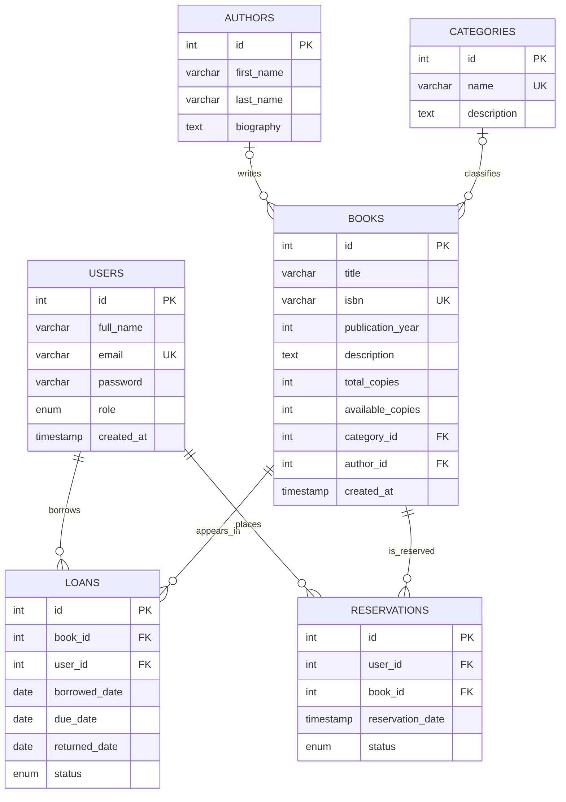

# BookNest — Implemented Entity-Relationship Diagram

This ERD describes the six tables that are actually implemented in `backend/database/booknest.sql` and used by the DAO and service layers. It replaces the earlier planning draft that included `BOOK_COPIES` and `BOOK_AUTHORS`; those are not separate tables in the current application.

## Relationships

- One user can have many loans; every loan references exactly one user.
- One book can appear in many loans; every loan references exactly one book.
- One user can place many reservations; every reservation references exactly one user.
- One book can have many reservations; every reservation references exactly one book.
- One author can be linked to many books. A book can have zero or one author because `books.author_id` is nullable.
- One category can contain many books. A book can have zero or one category because `books.category_id` is nullable.

## Database rules represented in SQL

- `users.email`, `categories.name`, and `books.isbn` are unique (ISBN may be NULL).
- `books.available_copies` must be between zero and `books.total_copies`.
- Loan `due_date` cannot be earlier than `borrowed_date`.
- Deleting an author or category sets the related book foreign key to NULL.
- Deleting a user or book cascades to its related loans and reservations in this current schema.
- User roles are `member` and `librarian`.
- Loan statuses are `Borrowed`, `Returned`, and `Overdue`.
- Reservation statuses are `Queued`, `Ready`, `Completed`, and `Cancelled`.

Open `ERD.svg` for the visual version of this same six-table schema.
