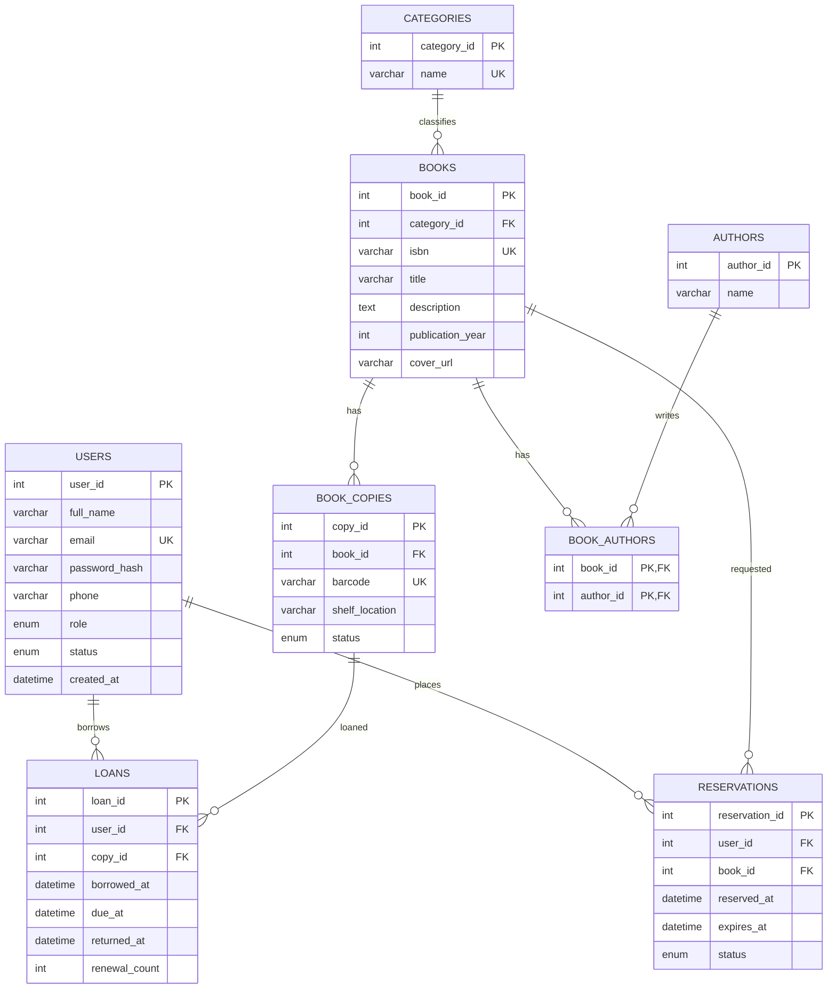

# BookNest — draft database schema

Planning only; no database connection or migrations are required in Milestone 1.

## Design decisions

- Eight entities, including the BOOK_AUTHORS junction table. A book may have several authors and an author may write several books.
- A category has zero or more books; each book has one category. Categories provide a simple primary classification.
- BOOKS describes a title/edition; BOOK_COPIES represents individual physical copies. ISBN is unique per edition and may be nullable for legacy books. Barcode uniquely identifies a copy.
- Reservations target a title, not a physical copy. The backend will allocate an available copy when processing the queue. A user and book can have many historical reservations.
- Loans target a copy. A copy can have many historical loans but at most one active loan (returned_at IS NULL). Enforce this in a transaction, with a database constraint where supported.
- USERS.role: member or librarian. USERS.status: active or suspended. Authentication and authorization are future backend work.
- Copy status: available, on_loan, held or maintenance. Reservation status: pending, ready, collected, cancelled or expired. Frontend availability labels are simplified aggregates, not stored book status fields.
- Prevent duplicate active reservations for the same user/title. Validate reservation limits, FIFO queue processing, due dates and renewals in the service layer.
- Dates: expires_at and returned_at may be NULL. Due date must be after borrowed_at; returned_at cannot precede borrowed_at.
- Preserve loan/reservation history: restrict deletion of referenced users, books and copies; use inactive/archive states instead. Junction records may cascade on author/book deletion only when allowed.
- Passwords must be hashed in the backend; never store plaintext passwords. Email is unique and normalized. IDs use integer primary keys; foreign keys are indexed.

Open `ERD.svg` for a standalone visual diagram, or preview this file in GitHub for the detailed Mermaid ERD.
